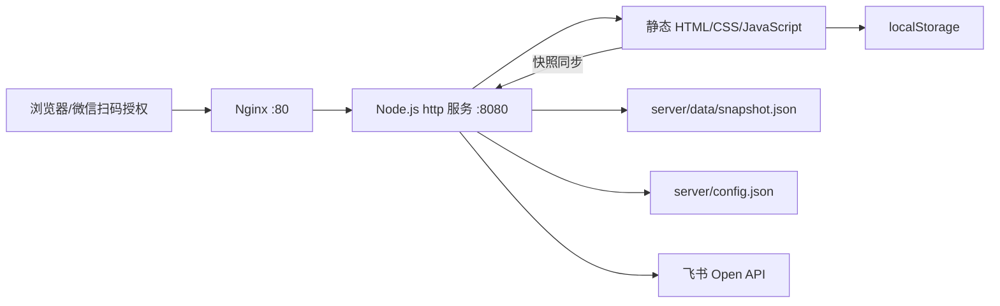

# 01 系统架构与开发环境

> 历史说明：本文保留旧版技术记录。当前架构请阅读 [架构 HTML](../人力资源管理系统开发架构.html) 与 [07-手机号账号与数据权限](./07-手机号账号与数据权限.md)。微信/飞书登录已取消，账号与会话由服务端管理，业务数据按角色范围访问；下文旧登录和浏览器账号相关描述不再适用。

## 1. 系统定位

人员管理系统面向华北一部酒仙桥运维团队，覆盖人员信息、楼栋和组织、考勤、请假、加班、调休时长、费用结算、微信扫码登录和飞书通知。系统采用轻量级前后端结构，前端负责页面和交互，Node.js 服务负责静态文件、数据快照接口以及微信、飞书服务端调用。

## 2. 总体架构



浏览器访问公网 80 端口，Nginx 将请求转发到本机 8080。Node.js 不依赖 Express 等 Web 框架，使用 Node 内置 `http`、`fs`、`path`、`crypto` 和全局 `fetch`。微信 AppSecret、飞书 App Secret 只在 Node 服务端读取。账号和会话仍由当前浏览器的 `localStorage`/`sessionStorage` 保存，不支持跨设备统一登录。

## 3. 技术选型

| 层次 | 技术 | 用途 |
|---|---|---|
| 页面 | HTML5 | 登录页、单页应用入口、状态页 |
| 交互 | 原生 JavaScript（ES5/ES6 混用） | 页面渲染、事件、校验和业务逻辑 |
| 样式 | CSS3、Flexbox、Grid、渐变、响应式规则 | 主题、表格、卡片和移动端适配 |
| 前端存储 | `localStorage` | 浏览器缓存、登录状态和离线数据 |
| 前端数据同步 | Fetch API | 与 `/api/data/*` 快照接口同步 |
| 服务端 | Node.js 20 LTS（当前部署参考） | 静态文件、JSON API、微信 OAuth 与飞书 API 代理 |
| 数据库 | MySQL 8.0（当前部署参考） | 共享快照主存储；JSON 文件作为初始化和灾备副本 |
| 网关 | Nginx 1.18 | 公网入口、反向代理和后续 HTTPS 扩展 |
| 进程管理 | systemd | 开机启动、异常拉起、日志查看 |
| 数据存储 | MySQL 8.0 + JSON 文件快照（当前部署参考） | MySQL 为主存储，JSON 仅用于初始化和灾备 |
| 外部平台 | 微信开放平台、飞书 Open Platform | 微信扫码登录、飞书应用消息 |
| 表格能力 | `js/xlsx.full.min.js` | Excel 导入/导出 |

参考部署通过 `server/package.json` 安装 `mysql2`，Node.js 20 提供其余服务端所需的全局 `fetch`。这里的 Node.js 20 和 MySQL 8 是现有部署示例，不代表最新版推荐；开发机版本需自行验证兼容性。

## 4. 开发环境要求

### 4.1 参考配置（当前部署示例，不代表最新版推荐）

- Windows 10/11、macOS 或 Ubuntu 22.04。
- Node.js 20 LTS、npm 10.x（与当前参考部署一致）。
- Git（如果项目接入版本库）。
- Chrome、Edge 或其他现代浏览器。
- PowerShell 7 或 Bash，用于执行检查和发布命令。
- 最少 2 GB 可用内存；日常开发不需要数据库服务。

### 4.2 本地启动

在项目根目录执行：

```bash
node server/server.js
```

默认监听 `0.0.0.0:8080`。本机浏览器打开 `http://localhost:8080`。Windows 也可以双击根目录的 `启动服务器.bat`，停止时使用 `停止服务器.bat`。

### 4.3 开发前检查

```bash
node --version
node --check server/server.js
node --check js/store.js
node --check js/app.js
node --check js/dashboard.js
node --check js/attendance.js
```

## 5. 项目目录

```text
项目根目录/
├─ index.html                 # 登录后的 SPA 主页面
├─ login.html                 # 用户名密码和微信扫码登录页面
├─ status.html                # 服务状态页面
├─ css/
│  ├─ style.css               # 基础布局和组件样式
│  └─ theme.css               # 科技感主题及可读性覆盖
├─ js/
│  ├─ store.js                # 数据存储、快照、结算和同步
│  ├─ auth.js                 # 用户登录、账号和微信用户映射
│  ├─ app.js                  # SPA 路由、导航、弹窗、提示
│  ├─ dashboard.js            # 数据看板
│  ├─ employees.js            # 人员管理
│  ├─ employee-profile.js     # 人员详情
│  ├─ attendance.js           # 考勤、加班、请假合并页面
│  ├─ leave.js                # 请假相关功能
│  ├─ overtime.js             # 加班相关功能
│  ├─ cost.js                 # 费用结算
│  ├─ org.js                  # 组织架构
│  ├─ performance.js          # 绩效
│  ├─ admin.js                # 系统设置、微信登录和飞书通知配置
│  ├─ permission.js           # 人员与系统账号绑定
│  ├─ feishu.js               # 飞书消息通知（登录已停用）
│  ├─ wechat.js               # 微信扫码 OAuth 登录
│  ├─ importer.js             # 导入/重置入口
│  ├─ ai.js                   # AI 问答界面
│  └─ xlsx.full.min.js        # Excel 运行库
├─ server/
│  ├─ server.js               # Node.js 服务端
│  ├─ package.json            # 服务端依赖（mysql2）
│  ├─ config.json             # 端口、微信登录、飞书和数据库配置
│  └─ data/                   # 服务器快照目录
├─ assets/                    # 示例表格等资源
└─ 技术文档/                  # 本文档集
```
